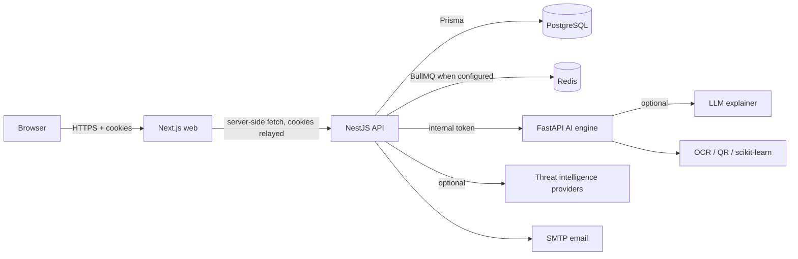

# ScamShield AI

**Detect scams. Understand threats. Stay protected.**

ScamShield AI is a full-stack consumer fraud-awareness platform built for India. It analyses
messages, links, screenshots, QR codes and emails, explains the evidence in plain language, and
gives people a safe next step. It is a working product, not a dashboard mock-up: scans are
persisted in PostgreSQL, analytics come from real records, and every button is wired to an API.

> **Honest status.** This repository is a production-oriented implementation, but it is not a
> certified security product. Risk scores are transparent product heuristics, not probabilities
> that something is a scam. External intelligence providers are optional. Do not present a clean
> scan as proof of safety, and do not claim the platform is "completely secure".

---

## What is implemented

| Area | Capability |
| --- | --- |
| Scanners | Pasted message (SMS/WhatsApp/Telegram/job/payment/bank), URL, screenshot OCR, QR decode (never auto-opened), email (pasted or `.eml`) |
| Detection | 19 weighted deterministic rules, URL structure + TLS + redirect inspection, email header analysis, optional TF-IDF/LogisticRegression text classifier, threat-registry matching |
| Scoring | Diminishing-returns aggregation with per-finding contributions, 0–100 heuristic, documented bands (0–24 low, 25–49 moderate, 50–74 high, 75–100 critical) |
| Explanations | Strict-schema LLM explanation of **structured findings only**, with prompt-injection resistance and a labelled deterministic fallback |
| Threat intelligence | Safe Browsing, VirusTotal, URLhaus, PhishTank (all optional), local verified registry, provider health, graceful degradation |
| Community | Evidence-based reports, duplicate detection, moderation queue, false-positive feedback; reports never auto-mark a domain malicious |
| Accounts | Session authentication (opaque tokens hashed at rest), CSRF double-submit, Argon2id passwords, email verification, password reset, optional TOTP MFA, session revocation, data export, account deletion |
| Admin | Platform analytics, user/role management, moderation, threat registry, provider/system health, audit log, strict server-side RBAC |
| UI | Responsive Next.js App Router app with the specified dark palette, charts from real data, loading/empty/error states, accessible primitives |
| Infrastructure | Dockerfiles for web/API/AI engine, Docker Compose, PostgreSQL + Redis, migrations, health checks, GitHub Actions CI |

---

## Architecture



The browser only talks to the Next.js origin. Session cookies are HTTP-only and are relayed
server-side; no access token is exposed to client JavaScript. The AI engine is internal-only.
See [docs/architecture.md](docs/architecture.md), [docs/database.md](docs/database.md),
[docs/api.md](docs/api.md) and [docs/ui.md](docs/ui.md).

### Monorepo layout

```
apps/
  web/        Next.js App Router UI + server actions
  api/        NestJS REST API, Prisma schema, migrations, seed, tests
  ai-engine/  FastAPI classifier, OCR, QR decoder, explanation service
packages/
  shared-types/  Domain contracts shared by API and web
  validation/    Zod schemas shared by API and web
docs/          Architecture, database ER diagram, API contract, UI structure, deployment
scripts/       Local PostgreSQL runner (no Docker required)
tests/         Cross-cutting test assets and fixtures (see tests/README.md)
.github/       CI workflow
```

---

## Quick start with Docker Compose

Requirements: Docker + Docker Compose v2.

```bash
cp .env.example .env

# Generate two independent 32-byte secrets and paste them into .env
openssl rand -base64 32   # APP_ENCRYPTION_KEY
openssl rand -base64 32   # INTERNAL_SERVICE_TOKEN

# For local HTTP only:
# COOKIE_SECURE=false

docker compose up --build
```

Then:

* Web: <http://localhost:3000>
* API: <http://localhost:4000> (health at `/health`, docs at `/api/docs` when `ENABLE_API_DOCS=true`)
* AI engine: internal network only (`:8000`, reachable from the API container)

The API container runs `prisma migrate deploy` on start. Create an administrator explicitly —
never rely on a default password in a deployed environment. The seed is idempotent, creates only
the account you specify, and leaves demo data disabled:

```bash
read -rsp "Admin password: " SEED_ADMIN_PASSWORD && export SEED_ADMIN_PASSWORD
docker compose exec -e SEED_ADMIN_EMAIL=you@example.com -e SEED_ADMIN_PASSWORD \
  -e SEED_DEMO_DATA=false api npm run prisma:seed -w @scamshield/api
unset SEED_ADMIN_PASSWORD
```

The seed is idempotent and only creates the catalog, roles, plans, threat sources and the admin
you specify. `SEED_DEMO_DATA=true` additionally creates local demo accounts; it refuses to run in
production.

---

## Local development without Docker

Node 20+, PostgreSQL 17 and Python 3.12 are required. Redis is optional: without `REDIS_URL`,
scans run inline and throttling uses in-process counters (fine for one instance, not for scale).

```bash
npm install
npm run build:packages

# If you do not have PostgreSQL installed, run the bundled real PostgreSQL 17:
node scripts/local-postgres.mjs > logs/postgres.log 2>&1 &
# database: scamshield, user/password: scamshield/scamshield on 127.0.0.1:5432

cp .env.example .env
# set DATABASE_URL, APP_ENCRYPTION_KEY, INTERNAL_SERVICE_TOKEN, REDIS_URL='' for inline mode
ln -s ../../.env apps/api/.env      # or copy it
ln -s ../../.env apps/web/.env.local
npm run db:generate
npm run db:migrate
npm run db:seed
npm run dev:api                     # http://localhost:4000
npm run dev:web                     # http://localhost:3000
```

AI engine (optional; scanners degrade honestly without it):

```bash
cd apps/ai-engine
python -m venv .venv && . .venv/bin/activate
pip install -r requirements.txt
uvicorn app.main:app --host 0.0.0.0 --port 8000
```

OCR needs Tesseract (`apt install tesseract-ocr`) or `rapidocr-onnxruntime`; QR needs OpenCV.
If neither is available, screenshot and QR scans fail with a clear error instead of inventing a
result. Configure `AI_ENGINE_URL` and the same `INTERNAL_SERVICE_TOKEN` on both services.

---

## Configuration

All variables are documented in [.env.example](.env.example). The most important:

| Variable | Purpose |
| --- | --- |
| `DATABASE_URL` | PostgreSQL connection string |
| `APP_ENCRYPTION_KEY` | 32-byte base64 key for AES-256-GCM content encryption (required in production) |
| `INTERNAL_SERVICE_TOKEN` | Shared secret for API → AI engine calls (required in production) |
| `APP_ORIGIN`, `CORS_ORIGINS` | Exact browser origin(s); wildcards are refused |
| `COOKIE_SECURE` | Must be `true` behind HTTPS; startup fails in production otherwise |
| `REDIS_URL` | Enables BullMQ scan queue and distributed throttling |
| `AI_ENGINE_URL`, `AI_ENGINE_ENABLED` | Internal AI service |
| `LLM_API_KEY` / `LLM_BASE_URL` / `LLM_MODEL` | Optional OpenAI-compatible explainer; without it a labelled template is used |
| `GOOGLE_SAFE_BROWSING_API_KEY`, `VIRUSTOTAL_API_KEY` | Optional reputation providers; unconfigured providers are skipped and disclosed |
| `URLHAUS_ENABLED`, `PHISHTANK_ENABLED` | Optional public feeds |
| `THREAT_INTEL_DEV_FIXTURES` | Deterministic dev fixtures; refused in production |
| `SMTP_*`, `EMAIL_ENABLED` | Optional email delivery; notifications never include submitted content |

No API key is committed. The stack runs without any external provider.

---

## Detection and scoring philosophy

* Deterministic rules are the source of the risk score. The ML classifier contributes a bounded
  supporting finding (maximum 24 points) and never overrides rule evidence.
* Each finding exposes its name, severity, evidence, detection method, source, timestamp,
  score impact and recommended action.
* Diminishing returns prevent one rule from dominating; a small bonus is added for genuinely
  independent corroborating sources.
* HTTPS never implies safety; unknown certificate state is reported as unknown.
* Absent SPF/DKIM/DMARC headers are **not** treated as fraud. A recorded failure is reported with
  the header as evidence.
* No confidence percentage is displayed. The classifier is trained and evaluated on a small
  synthetic dataset and is explicitly labelled uncalibrated.
* Empty results say "no strong indicators found" and list limitations — never "safe".

## AI safety

The LLM receives only structured findings (title, severity, evidence summary, recommended
action) — never the raw message, URL, screenshot or email. This removes the main prompt-injection
channel. The system prompt treats all data as untrusted, output is validated for shape, length and
forbidden claims, and any failure falls back to a deterministic explanation labelled
`Rule-based summary`. The LLM cannot change the score.

## Security controls (OWASP ASVS-informed, not a certification)

Session tokens are 256-bit, hashed at rest, stored in `HttpOnly`/`SameSite=Lax` cookies, with a
double-submit CSRF token bound to the session. Passwords use Argon2id. Account lockout, generic
login errors, rate limits, strict Zod validation, parameterised Prisma queries, React escaping,
CSP and secure headers, CORS allowlisting, magic-byte upload validation, audit logging and
server-side RBAC are implemented. URL scanning blocks private/loopback/link-local/metadata/CGNAT
ranges, IP literals and non-standard ports, pins validated DNS addresses to prevent rebinding,
revalidates every redirect, caps time and response size, and never executes page JavaScript. QR
destinations are shown as text and never opened.

See [SECURITY.md](SECURITY.md) for reporting and the exact limits of these controls.

---

## Testing

```bash
npm run typecheck                 # packages + API + web
npm run test:api                  # Jest unit + PostgreSQL integration tests
npm run test:web                  # Vitest helper/threshold tests
cd apps/ai-engine && python -m pytest tests -q
cd apps/ai-engine && python scripts/evaluate.py
```

API tests run against `scamshield_test` (`TEST_DATABASE_URL`). They cover rule detection,
credential-request false positives, scoring transparency, SSRF rejection, TOTP, email header
analysis, CSRF enforcement, cross-user scan isolation, RBAC and session invalidation. The AI
evaluation reports precision/recall/F1 on a held-out synthetic split and states that it is not a
real-world accuracy claim.

## API documentation

With `ENABLE_API_DOCS=true`, Swagger is served at `/api/docs`, generated from the NestJS
controllers. The contract summary lives in [docs/api.md](docs/api.md) and the exported document is
[docs/openapi.json](docs/openapi.json) (50 paths). Regenerate it after API changes with:

```bash
npm run build -w @scamshield/api
npm run openapi:export -w @scamshield/api
```

## Privacy and data handling

Raw content is encrypted with AES-256-GCM for processing. Storing it after the scan requires
explicit consent; otherwise only a redacted preview and hash are retained and the ciphertext is
purged on completion. Consented content is deleted on the user's retention schedule (7–365 days)
with a fallback purge job. Users can export their data and delete their account from the security
centre. Community reports are detached from identity on deletion; moderator identities are never
public.

## Deployment

### Render (Blueprint included)

The repository ships a [Render Blueprint](render.yaml) that provisions the web app, API, AI engine,
Postgres and shared secrets in one stack (scans run inline on the free plan; add Key Value for BullMQ
on a paid plan). See [docs/render.md](docs/render.md) for the
step-by-step guide, first-admin bootstrap and free-plan caveats (a free Render Postgres expires
after 30 days).

### Docker Compose / self-hosted

See [docs/deployment.md](docs/deployment.md). Production checklist: TLS termination, secure
cookies, strong secrets, real PostgreSQL backups, Redis, a reachable AI engine (or deliberately
disabled), SMTP, provider keys stored as secrets, monitoring of `/health` and `/health/ready`, and
a tested restore procedure. Payments are deliberately not implemented; the pricing page says so.

## Known limitations

* The classifier is trained on synthetic data and is not calibrated for production accuracy.
* OCR quality depends on the installed engine and image quality.
* URL scanning can be evaded by sites that block automated clients; the result says so.
* Public threat feeds have rate limits and can be stale or unavailable; coverage is disclosed.
* Without Redis, queue state is in-process and does not survive restarts.
* Community reports require human moderation; volume is not a verdict.
* No platform can guarantee safety, and this one does not claim to.

## Licence

No licence has been declared for this repository. Add one before distributing it.
