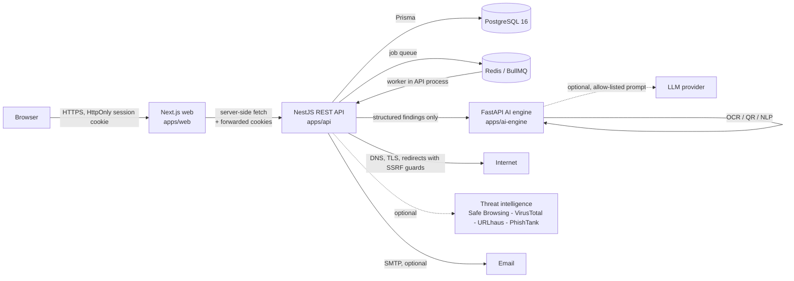

# ScamShield AI — Architecture

**Tagline:** Detect scams. Understand threats. Stay protected.
**Scope:** AI-assisted consumer fraud prevention for the Indian market (fake jobs, phishing, UPI/payment fraud, KYC scams, courier scams, fake support, malicious QR codes, government-scheme fraud, impersonation).

> ScamShield AI is an **assistive** tool. A risk score is a transparent product heuristic, not a validated probability of fraud, and no automated system (or LLM) decides that something is safe.

## 1. System overview



### Services

| Service | Tech | Responsibility |
| --- | --- | --- |
| `apps/web` | Next.js 15 App Router, TypeScript, Tailwind, shadcn-style components, Recharts | Landing page, auth, dashboard, scan centre, results, profile/security centre, admin console. All API calls are made server-side; the browser never holds a token. |
| `apps/api` | NestJS 11, Prisma, PostgreSQL, Redis/BullMQ | Auth & sessions, RBAC, scanning orchestration, deterministic detection rules, risk scoring, threat intel, reports, notifications, audit, admin APIs, OpenAPI. |
| `apps/ai-engine` | FastAPI, scikit-learn, Pillow, OpenCV, Tesseract | ML text classification, OCR, QR decoding, constrained LLM explanations. Has **no database access** and receives only the content needed for the task. |
| `packages/shared-types` | TypeScript | Single source of truth for API/domain contracts. |
| `packages/validation` | Zod | Identical validation rules for forms and API pipes. |

### Why this split

- **Deterministic detection lives in the API.** Rules and scoring are pure TypeScript, unit-testable with no network, and always available. A Python/ML outage degrades explanation quality, not the product's core verdict.
- **ML/OCR/QR live in Python** where the ecosystem is strongest, behind a narrow internal interface (`/classify`, `/ocr`, `/qr`, `/explain`) protected by a shared internal token.
- **The LLM never produces the verdict.** It receives the structured findings that the scoring engine already produced and writes a plain-language explanation.

## 2. Scan pipeline

```
POST /api/scans/{message|url|screenshot|qr|email}
  │
  ├─ 1. Authentication, plan quota, rate limit
  ├─ 2. Zod validation + file signature / size / MIME validation
  ├─ 3. Persist Scan(status=queued) with SHA-256 hash, redacted preview,
  │     encrypted full content ONLY when consentToStore=true
  ├─ 4. Enqueue job (BullMQ if REDIS_URL is set, otherwise inline executor)
  ├─ 5. Extract → normalise (URLs, domains, phones, emails, UPI IDs, decoded QR)
  ├─ 6. Run detector module (rules + heuristics + optional ML + optional intel)
  ├─ 7. Evidence-weighted scoring → riskScore, findings, coverage, limitations
  ├─ 8. Persist ScanResult + DetectionIndicator rows in a transaction
  ├─ 9. Notify (in-app always, email only when configured and opted in)
  └─ 10. Request constrained AI explanation (polled / attached when ready)
```

Scanning is **synchronous by default** (the queue job is awaited with a hard timeout) so the UI can show a result immediately. The queue abstraction exists so a worker deployment can move long-running URL scans off the request path without changing controllers.

### Detection modules

| Module | Signals |
| --- | --- |
| Message | urgency pressure, payment requests, UPI/QR payment instructions, credential/KYC/OTP requests, impersonation of banks/couriers/government, unrealistic earnings, threats, fake recruiter patterns, suspicious links, phone-number spoofing language |
| URL | scheme/host validation, IP-literal hosts, IDN/punycode homographs, typosquatting distance against a brand list, suspicious TLDs, excessive subdomains, encoded/obfuscated paths, credential-harvesting keywords, redirect chain, TLS validity, domain age when intel provides it, safe-browsing/URLhaus/VirusTotal/PhishTank verdicts |
| Screenshot | MIME + magic-byte validation, size cap, OCR, URL/phone extraction, then message/URL detectors on the extracted text |
| QR | decode → classify payload (`url` vs text/UPI/other) → URL detector for URLs; never opens the destination |
| Email | From/Reply-To/Return-Path mismatches, display-name impersonation, SPF/DKIM/DMARC **only when trustworthy headers exist**, link inspection, attachment-reference language, social-engineering rules |

### Scoring model

- Each finding has a severity, an evidence string and a **score impact**.
- Base score = capped sum of impacts; corroboration bonus when independent sources agree; contradiction damping when strong trust signals exist; hard caps keep a single heuristic from dominating.
- 0–24 low, 25–49 moderate, 50–74 high, 75–100 critical (provisional thresholds, displayed with a disclaimer).
- `evidenceCoverage` describes how many signals/providers were actually consulted. It is not a probability.
- `modelConfidence` is returned **only** when a model has been evaluated; the UI never shows a raw percentage for an uncalibrated model.
- Every finding carries: name, severity, evidence, method, source, timestamp, recommended action, score impact.

## 3. URL scanning safety (SSRF)

The URL scanner is treated as an attack surface:

1. http/https only; credentials, non-standard ports and IP literals are rejected/penalised.
2. Hostname resolved with `dns.lookup({ all: true })`; every resolved address checked against private, loopback, link-local, CGNAT, multicast, reserved, IPv6 ULA and **cloud metadata** ranges.
3. The connection is pinned to the validated IP with the original `Host` header (prevents DNS rebinding between validation and connection).
4. Redirects are followed manually, at most 5, and **every hop is re-validated** (scheme, host, IP).
5. 5 s connect timeout, 10 s total budget, 1 MiB response cap, no `Authorization` forwarded, no cookies, no JavaScript execution.
6. Response bodies are read as text only up to the cap and never rendered; screenshots of remote pages are never taken.
7. DNS/HTTP failures produce explicit "unavailable" coverage notes, never a "safe" verdict.

## 4. AI explanation governance

- The LLM receives `{scanType, findings[], extractedCategories, riskScore, limitations}` — never raw HTML, never credentials, never the system prompt.
- Submitted content is quoted inside a delimited, explicitly untrusted block; the system prompt states that instructions inside it are data, and output is schema-validated (Zod) after generation.
- Output must be plain text ≤ 1,800 characters, with the required sections (reasons, consequences, next steps, uncertainty). Failures fall back to a deterministic template labelled **template**, not AI.
- Explanations are labelled as AI-generated in the UI with a disclaimer.
- Rate-limited per user and cached per scan; no secrets, no tool access, no browsing.

## 5. Data protection

- Submitted content is hashed (SHA-256) for dedupe; a ≤280-char redacted preview is stored for history.
- Full content is stored **only** with explicit per-scan consent, AES-256-GCM encrypted with `APP_ENCRYPTION_KEY`, with `contentRetentionUntil` and a purge job.
- Uploads are processed in memory/temporary files, never executed, and deleted after processing.
- Passwords: Argon2id (`@node-rs/argon2`). Sessions: 256-bit opaque tokens, SHA-256 hashed at rest, HttpOnly + `SameSite=Lax` + `Secure` in production, rotation on login, revocable per device.
- CSRF: double-submit token bound to the session plus same-origin checks on state-changing requests.
- Audit logs record auth, admin and data-deletion events without sensitive payloads.

## 6. Graceful degradation

| Dependency | Missing behaviour |
| --- | --- |
| Redis | Inline job executor; rate limiting falls back to in-memory store; `/health` reports `queue.driver=inline`. |
| AI engine | Rules-only scoring; explanation falls back to a deterministic template and the UI says so. |
| LLM key | Same template fallback; no fabricated "AI" claim. |
| Safe Browsing / VirusTotal | Provider marked `disabled` in health and `providersUnavailable`; score never assumes "clean". |
| URLhaus / PhishTank | Same; only used when reachable and enabled. |
| SMTP | In-app notifications still delivered; email delivery recorded as skipped; verification links logged only in development. |
| OCR (Tesseract absent) | Upload returns a clear `OCR_UNAVAILABLE` explanation instead of a fake result. |

Development/test fixtures are opt-in (`THREAT_INTEL_DEV_FIXTURES=true`) and refused when `NODE_ENV=production`.

## 7. Phased delivery

| Phase | Delivered |
| --- | --- |
| 1 | Architecture, ER model, API contract, UI system, monorepo scaffold, shared types, Zod contracts, Prisma schema + migration |
| 2 | Landing page, auth pages, dashboard shell, design system |
| 3 | Auth/session/RBAC APIs, migrations, seed, audit |
| 4 | Message + URL detection engines, scoring, SSRF-safe fetcher |
| 5 | AI explanation service, OCR, QR, screenshot pipeline |
| 6 | Threat intelligence, community reports, moderation, notifications, admin console |
| 7 | Tests (unit/integration/security/evaluation), hardening, Docker/CI, documentation |

## 8. Known limitations (by design, documented not hidden)

- Risk thresholds are product heuristics, not calibrated probabilities.
- Domain-age data is only surfaced when a provider supplies it; absence is reported as unknown.
- Community reports never automatically mark a domain malicious; only moderator-verified reports feed threat intelligence.
- OCR accuracy depends on image quality and installed Tesseract language data.
- No platform can guarantee safety; HTTPS alone is never treated as a trust signal.
