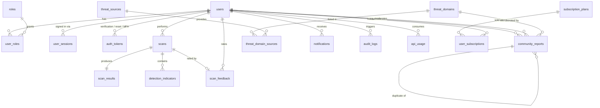

# ScamShield AI — Database design

PostgreSQL 16, Prisma ORM, UUID (`uuid` type) primary keys, `ON DELETE` behaviour chosen per relationship.

## Entity relationship diagram



## Tables

| Table | Purpose | Key constraints / indexes |
| --- | --- | --- |
| `users` | Account, Argon2id hash, MFA secret (encrypted), lockout counters, JSON preferences, soft delete | unique lowercased `email`; indexes on `createdAt`, `emailVerifiedAt`, `deletedAt` |
| `roles` | `user`, `moderator`, `admin` with permission strings | unique `name` |
| `user_roles` | Role assignments | unique `(userId, roleId)`, FK cascade, `assignedBy` set-null |
| `user_sessions` | Opaque session tokens (SHA-256 hash), CSRF hash, device metadata | unique `tokenHash`; index `(userId, revokedAt)`, `expiresAt` |
| `auth_tokens` | Email verification, password reset, MFA challenge; single-use | unique `tokenHash`; index `(userId, purpose)` |
| `scans` | Scan envelope: type, status, hash, redacted preview, encrypted content (consent only), denormalised score/level for list queries | index `(userId, createdAt desc)`, `status`, `inputHash`, `riskLevel`, `primaryCategory`; soft delete |
| `scan_results` | Full structured analysis JSON + coverage, engine, limitations | unique `scanId`, FK cascade |
| `detection_indicators` | One row per finding (name, severity, evidence, method, source, action, impact) | index `scanId`, `key`, `source` |
| `scan_feedback` | Correct / incorrect / unsure, drives false-positive review | unique `scanId`, index `verdict` |
| `threat_sources` | Feed or manual source, reliability score, enabled flag | unique `name` |
| `threat_domains` | Verified malicious domain registry | unique `domain`, index `(verified, active)`, `lastSeenAt` |
| `threat_domain_sources` | Provenance per domain; raw evidence | unique `(domainId, sourceId, externalRef)` |
| `community_reports` | User-submitted reports with moderation state, duplicate link, optional promoted domain | index `(status, createdAt desc)`, `targetHash`, `reporterId` |
| `notifications` | In-app alerts, read state, email delivery marker | index `(userId, readAt)`, `(userId, createdAt desc)` |
| `audit_logs` | Security and admin actions, no sensitive payloads | index `actorId`, `action`, `createdAt desc` |
| `api_usage` | External provider call telemetry (latency, success), not billable metering | index `(provider, createdAt desc)`, `(userId, createdAt)` |
| `subscription_plans` | Seeded Free / Plus / Business quotas | unique `slug` |
| `user_subscriptions` | Active plan per user | index `(userId, status)` |

## Data-handling rules

1. **Minimisation.** `scans` stores `inputHash`, `inputLength`, a redacted ≤280-char `inputPreview` and the derived findings. The raw payload is not persisted unless the user consents on that scan.
2. **Encryption at rest for consented content.** AES-256-GCM with `APP_ENCRYPTION_KEY`; stored as `v1:<iv>:<tag>:<ciphertext>`; never logged; returned only to the owning user.
3. **Retention.** `contentRetentionUntil` is set from the user's `privacyPreferences.retentionDays` (default 30, max 365). A scheduled purge nulls content and reports are anonymised on account deletion.
4. **Community privacy.** Reports store a moderator-visible target plus a `targetHash`; public threat views never expose reporter identity, emails or phone numbers (numbers are masked).
5. **Soft delete.** Only `users` and `scans` use `deletedAt`. Deleting an account hard-deletes sessions/tokens, anonymises reports and removes scans (cascade) — documented in the privacy centre.
6. **Idempotent dedupe.** `inputHash` enables repeat-scan detection; duplicate community reports are flagged, not merged silently.
7. **Transactions.** Scan completion writes `scans` + `scan_results` + all `detection_indicators` in one transaction; report moderation updates the report and threat domain atomically.

## Migration workflow

```bash
cd apps/api
npx prisma migrate dev --name init     # local development
npx prisma migrate deploy              # CI / production
npx prisma generate
npm run prisma:seed -w @scamshield/api # roles, plans, threat sources, demo accounts (dev only)
```

Committed migrations live in `apps/api/prisma/migrations/`. Seed data contains **no** real user content and is idempotent.
